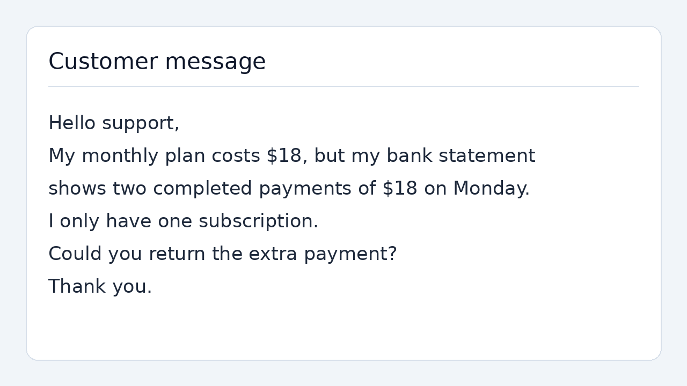

# Qwen Choice

[简体中文](README.md) | **English**

Local visual decisions with **Qwen3.5-4B**. Supply one image, one question, and a fixed set of choices. A single model forward pass returns the selected choice and a probability distribution over the options.

**Measured on one RTX A6000: 169 ms median request latency, 174 ms P95.** Uses the original BF16 weights with thinking disabled, without training or quantization.

## Example

Answer one question: **Which support category best matches the customer's message in the image?**

The choices are `billing`, `technical`, `sales`, and `other`.



The customer reports a duplicate payment, and the model selects `billing`. The message and image are fictional. See [support_ticket.json](examples/support_ticket.json) for the question and option definitions.

## Performance

Measured on September 21, 2026, with both vision and language model compilation enabled.

| Metric | Result |
|---|---:|
| Median request latency | **168.694 ms** |
| P95 request latency | **173.989 ms** |
| Median GPU model stage | 137.378 ms |
| Measured requests | 30 |
| Matches to the example's expected answer | 30 / 30 |

Configuration: one RTX A6000, BF16, batch size 1; one 1280×720 image, one question, and four choices. Official processor defaults produce 880 visual tokens and 989 total input tokens.

- **Request latency** starts with an RGB image in host memory and ends when the choice and probabilities are available. It includes image preprocessing, tokenization, CPU-to-GPU transfer, model computation, and result readout, with synchronized CUDA boundaries.
- **GPU model stage** is measured with CUDA events after input transfer and before result transfer. It includes vision encoding and the language model, and may include gaps between host kernel submissions.
- Model loading, image file I/O, compilation, warmup, separate input verification, and log writes are excluded from steady-state latency. The fixed question's text template is prepared in advance; images and model outputs are recomputed for every request.
- Five warmup requests precede measurement. Compilation setup and these five warmup requests took approximately 14.1 seconds with existing machine compilation caches. Startup time can differ on other systems.

The benchmark alternates between two input preparation paths, measuring 30 requests per path. The table reports `profiles.fast`. Evidence: [summary and checks](results/language_compile_v3/summary.json), [per-request records](results/language_compile_v3/records.jsonl), and [GPU kernel audit](results/operator_audit.json).

This measures latency on one fixed example. Thirty repetitions are not a general accuracy evaluation. Probabilities are softmax-normalized scores over the supplied options and are not calibrated. Compilation can introduce small numerical differences; bitwise equivalence is not guaranteed.

## How it works

```text
Image + question + choices
           ↓
Official image processor and tokenizer
           ↓
Vision encoder + language model: one forward pass
           ↓
Output scores at the final position
           ↓
Select answer-letter scores → softmax → choice and probabilities
```

- **Direct decisions:** represent each option with a single-token letter and score all candidates in one forward pass, skipping autoregressive generation. The original output head is applied only at the final position.
- **Fast kernels:** causal-conv1d, FLA gated delta rule, fused gated RMSNorm, and FlashAttention through PyTorch SDPA. Runtime profiling confirms that the corresponding GPU kernels execute.
- **Compilation:** the vision encoder uses `torch.compile`; `--compile-language` also compiles the language model. Graph breaks are allowed, and actual compiled execution is recorded.
- **Lower preparation overhead:** reuse the fixed question's text template and perform diagnostic hashing in separate verification. Larger input tensors use pinned memory and nonblocking transfers.

Images, visual features, answers, and language states are not reused across requests. Each instance handles requests sequentially.

## Installation

Requires an NVIDIA CUDA GPU. Tested with Python 3.11, PyTorch 2.11.0+cu130, Transformers 5.13.1, FLA 0.5.2, and Triton 3.6.0.

```bash
python -m venv .venv
source .venv/bin/activate
pip install torch==2.11.0 --index-url https://download.pytorch.org/whl/cu130
pip install packaging ninja
pip install --no-build-isolation -r requirements.txt
```

The `causal-conv1d` build must match PyTorch, CUDA, and the GPU architecture. The measured environment used a local `1.7.0+cu13torch2.11sm86` build. Missing required fast kernels cause an explicit error rather than a silent slow-path fallback.

## Run

Load the model from Hugging Face:

```bash
python benchmark_fast.py \
  --model Qwen/Qwen3.5-4B \
  --compile-language \
  --output results/local-run
```

Use existing local weights:

```bash
python benchmark_fast.py \
  --model /path/to/Qwen3.5-4B \
  --local-files-only \
  --compile-language \
  --output results/local-run
```

The output directory must not already exist. Read `profiles.fast` in `summary.json`; individual outputs are saved in `records.jsonl`. Remeasure after changing image dimensions, questions, or choices.

## Files

| File | Purpose |
|---|---|
| [qwen_choice.py](qwen_choice.py) | Single-image decisions, score readout, and fast-kernel checks |
| [qwen_choice_fast.py](qwen_choice_fast.py) | Reusable question templates and input preparation |
| [benchmark_fast.py](benchmark_fast.py) | Language model compilation, paired timing, and input equality checks |
| [examples/](examples/) | Fictional message image, question, and choices |
| [requirements.txt](requirements.txt) | Python dependencies |

## Sources

The question design draws on Jev's Choice pattern and public support-classification examples. See [SOURCES.md](SOURCES.md). This project runs Qwen locally, makes no Jev API calls, needs no TypeSafe key, and is not affiliated with TypeSafe.

Model weights are obtained separately from [Qwen/Qwen3.5-4B](https://huggingface.co/Qwen/Qwen3.5-4B) and remain subject to the model publisher's license terms.
